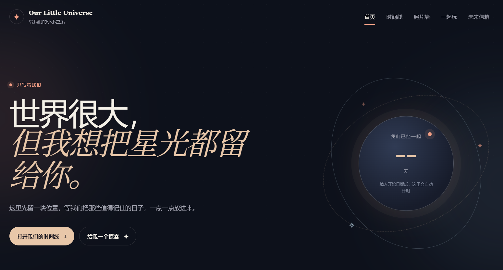
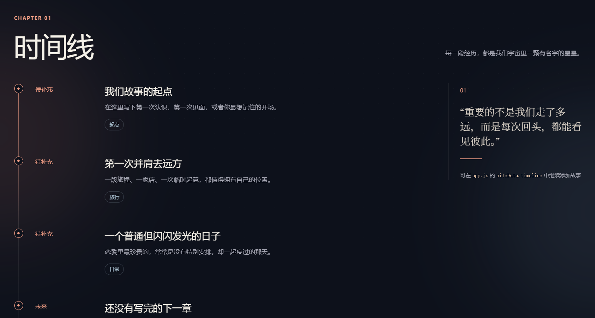
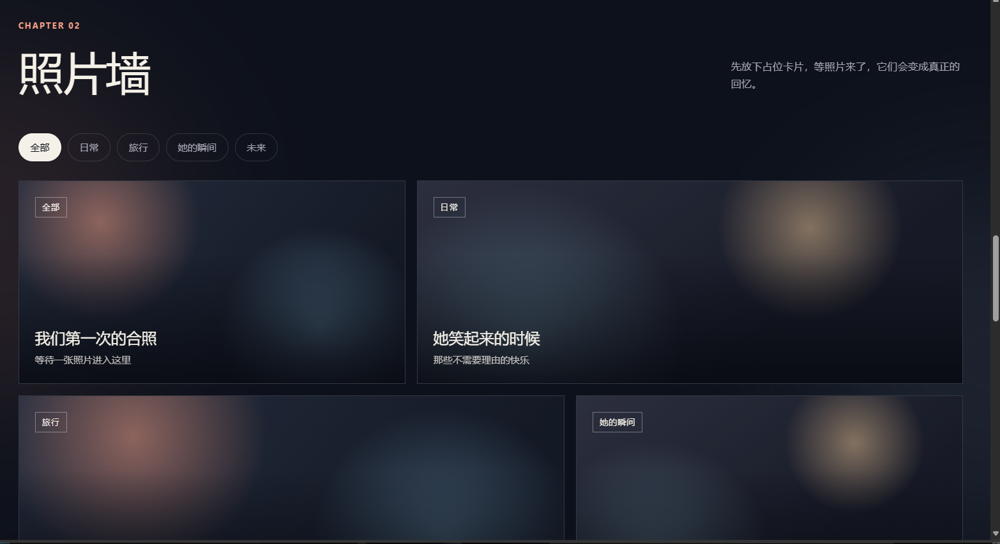
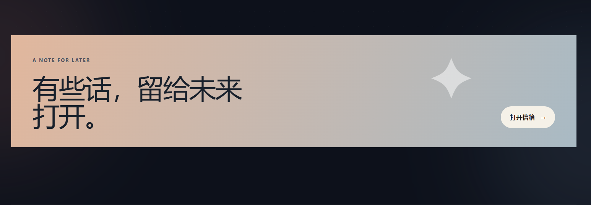

# Our Little Universe

这是一个前后端分离的私人恋爱回忆网站：前端是静态 HTML/CSS/JavaScript，后端是 Express API，内容存储在本机 MySQL 5.7.44（localhost:3306）中。

完整操作步骤请查看：[操作文档.md](./操作文档.md)

## 功能介绍

Our Little Universe 是一座可以持续补充的专属数字回忆馆。它把恋爱中的日期、照片、故事和互动游戏放在同一个可长期维护的空间里，既可以作为本地私人网站，也可以在完成安全配置后发布给特定的人访问。

### 面向访问者的功能

- **专属首页**：自定义网站名称、首页文案、恋爱开始日期和恋爱天数。
- **恋爱时间线**：按故事顺序记录第一次认识、第一次见面、旅行、纪念日和未来计划。
- **分类照片墙**：按日常、旅行、她的瞬间、未来等分类展示照片卡片。
- **记忆问答**：把你们之间才知道的问题做成互动选择题。
- **时间拼图**：将重要事件打乱，由访问者重新排回你们的真实顺序。
- **未来信箱**：写下给未来的信，保存到本地 MySQL 数据库。
- **隐藏彩蛋**：点击星标并输入专属暗号，解锁隐藏内容。
- **响应式设计**：适配桌面、平板和手机屏幕。
- **离线降级**：直接打开 `index.html` 也能看到完整的占位体验。

### 面向维护者的功能

- **无登录内容管理页**：通过 `manage.html` 修改首页、时间线、照片墙和互动题库。
- **数据库持久化**：所有主要内容写入 MySQL 5.7.44，而不是散落在前端代码里。
- **前后端分离**：前端静态资源和后端 API 可以分别运行在 `5173` 与 `3000`。
- **完整 CRUD API**：支持时间线、照片墙、问答、拼图和未来信件的读取与写入。
- **初始化与备份脚本**：提供建表、种子数据、数据库备份和恢复说明。
- **本地优先**：默认使用 `localhost`，不依赖第三方云数据库。

### 技术架构

```text
浏览器
  ├── index.html / manage.html
  ├── styles.css / manage.css
  └── app.js / manage.js
          │ HTTP JSON API
          ▼
Express + Node.js
          │ mysql2
          ▼
MySQL 5.7.44
```

本项目默认面向私人使用。当前管理 API 没有登录层，因此不应直接暴露到公网；如需使用 Cloudflare Tunnel，建议先为管理端增加认证或访问限制。

## 界面预览

以下截图展示了当前模板的主要页面。示例中的日期、文字和照片卡片是占位内容，可以通过管理页替换成你们自己的故事。

### 首页与恋爱计时

首页集中展示专属标题、恋爱天数、开始时间入口和进入时间线的主按钮。



### 恋爱时间线

时间线用章节化的方式记录重要经历，每个条目包含日期、标题、故事内容和标签。



### 分类照片墙

照片墙支持按全部、日常、旅行、她的瞬间和未来等分类筛选，图片文件放在 `media/photos/` 后即可从管理页关联。



### 未来信箱

未来信箱适合保存写给未来的文字，后端模式下会写入 MySQL，离线模式下会保存到当前浏览器。



## 第一次运行

电脑已经确认具备 Node.js 16.20.2、npm 和 MySQL 5.7.44。首次运行只需要在项目目录执行：

```bash
npm install
npm run db:init
npm start
```

然后打开：

- 展示页：<http://localhost:3000/>
- 内容管理页：<http://localhost:3000/manage.html>
- 数据库健康检查：<http://localhost:3000/api/health>

如果要验证“前后端分离”运行方式，可以让后端保持在 3000，再在另一个终端把当前目录作为静态前端启动在 5173：

```bash
python -m http.server 5173
```

然后打开 <http://localhost:5173/>。`index.html` 和 `manage.html` 已将 API 地址配置为 `http://localhost:3000`；部署到别的后端地址时，修改页面底部的 `LOVE_API_BASE_URL` 即可。

默认连接配置就是用户要求的 `localhost:3306 / root / 123456 / love_universe`。如果以后要更换配置，复制 `.env.example` 为 `.env` 后修改即可。`.env` 不要上传到公网或代码仓库。

## 恋爱信息从哪里补充

推荐使用管理页，不需要手动写 SQL：

1. 启动 `npm start`。
2. 打开 <http://localhost:3000/manage.html>。
3. 在“首页文案与日期”中填写恋爱开始日期、标题、暗号等。
4. 在“时间线”中新增或编辑经历。
5. 在“照片墙”中填写分类、标题、说明和图片相对路径。
6. 回到展示页刷新即可看到数据库中的内容。

图片建议放在项目目录的 `media/photos/` 下，例如：

```text
media/photos/first-meeting.jpg
```

管理页中填写：

```text
media/photos/first-meeting.jpg
```

网站会优先从后端 API 读取数据库；如果直接双击 `index.html`，仍会显示内置的离线占位内容。

## 数据库结构

- `site_settings`：首页名称、文案、开始日期、彩蛋暗号
- `timeline_items`：时间线
- `gallery_items`：照片墙
- `quiz_questions`：记忆问答
- `order_items`：时间拼图
- `future_letters`：未来信件

建表和初始化数据分别在 `db/schema.sql`、`db/seed.sql`。初始化脚本是幂等的，重复执行不会覆盖已有内容。

## API

- `GET /api/site`：获取展示页全部内容
- `PUT /api/site/settings`：保存首页设置
- `POST/PUT/DELETE /api/timeline`：管理时间线
- `POST/PUT/DELETE /api/gallery`：管理照片墙
- `GET/POST /api/letters`：读取和保存未来信件

当前按你的要求没有登录层，适合本机或可信内网使用。不要直接把这个管理 API 暴露到公网；如果需要 Cloudflare Tunnel，建议只公开展示页，管理端留在本机。

## 备份

备份数据库：

```bash
mysqldump -h localhost -P 3306 -u root -p123456 love_universe > love_universe_backup.sql
```

恢复数据库：

```bash
mysql -h localhost -P 3306 -u root -p123456 love_universe < love_universe_backup.sql
```

同时备份项目目录中的 `media/`，因为数据库只保存图片路径，不保存图片文件本身。
